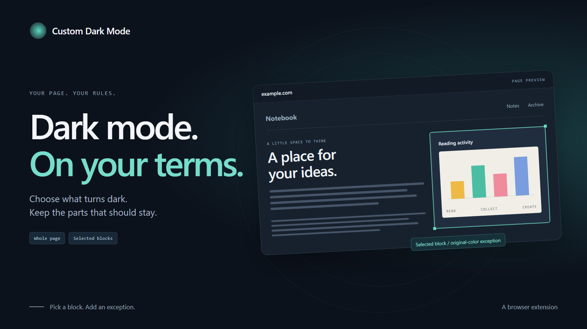
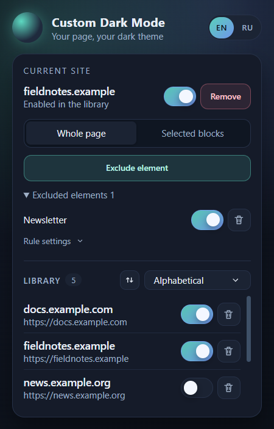

# Custom Dark Mode

A Chrome extension for building a dark theme on each site: invert the whole page with exclusions, or invert only selected blocks.





More screenshots: [whole-page mode](docs/screenshots/whole-page.png) · [selected blocks](docs/screenshots/selected-blocks.png).

## Install

Requires Chrome 119 or newer. Open `chrome://extensions/`, enable **Developer mode**, click **Load unpacked**, and select this folder. No build step is needed.

After source changes, reload the extension and refresh already open themed tabs.

## Use

Open a site, open the popup, and click **Add site**. Sites outside the library stay unchanged.

- **Whole page** inverts the page. **Exclude element** adds exceptions to the page theme.
- **Selected blocks** leaves the page unchanged until you **Configure block**. Add exceptions inside the block to preserve their original rendered colors without reversing the inversion.

Click an element to preview it. **Larger** and **Smaller** adjust the selection. Choose **Similar elements** to include matching current and future elements; check the outlines and match count before saving.

**Save** commits the block and its exceptions together. **Back** or Escape during exception selection discards that exception; closing the editor discards the entire draft. Click a saved block in the popup to edit it again.

Each rule has its own pause switch. **Rule settings** lets you name it and **Show matches on page** highlights its current matches. A block's nested exceptions have the same controls.

Pause a site from **Current site** or the library. Switching modes retains both rule sets; removing a site deletes its rules, with a short **Undo** window. A library entry covers one protocol and hostname, across paths and ports.

The popup provides library sorting and settings export/import. Export before moving an unpacked extension: Chrome gives a moved folder new storage. Import is also available on the extension's **Options** page.

## Privacy

HTTP/HTTPS access is requested once. Theme scripts are registered only for enabled library sites with granted access. Withholding access in Chrome suspends the theme without deleting its settings.

Site rules stay in local storage; language and sorting use Chrome sync storage. There is no analytics, remote code, external asset loading, or extension-initiated network traffic.

See the [privacy policy](PRIVACY.md) for details.

## Development

Requires Node.js 22 or newer:

```sh
node scripts/check-all.mjs
```

This runs static checks and unit tests. GitHub Actions also runs the headless browser suites with Playwright 1.63.0. To run every browser suite locally, set `HDM_PLAYWRIGHT_PATH` to an installed `playwright-core/index.mjs` and `HDM_CHROMIUM` to its full Chromium executable, then run `node scripts/check-all.mjs --browser`. Without Playwright configured, browser checks are skipped. Suites use isolated profiles and most need window focus.

## License

[MIT](LICENSE)
